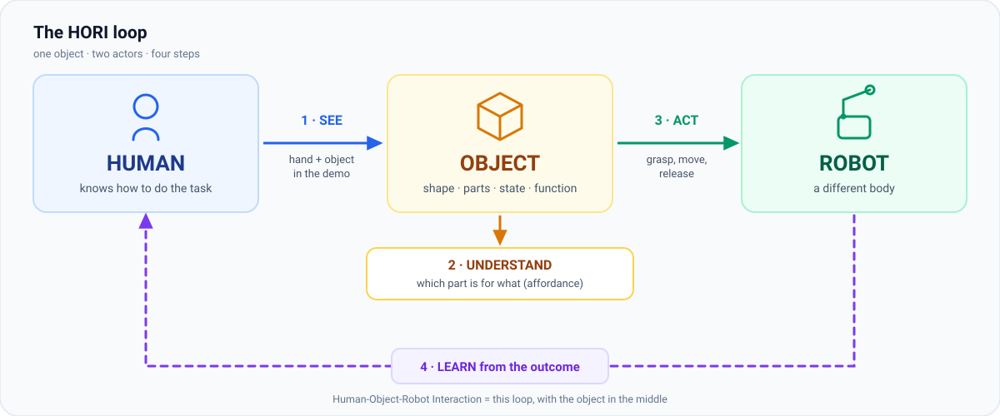

<div align="center">

# Awesome Human-Object-Robot Interaction

**A curated list about one object shared by a human and a robot.**

[](https://awesome.re)
[](https://creativecommons.org/publicdomain/zero/1.0/)
[](CONTRIBUTING.md)

**90 papers** · **21 datasets** · **13 tools** · last updated 2026-11-21

</div>



> **In one sentence**
> HORI asks: *can a robot watch a human use an object, understand what that object offers, and then use it with a different body?*

Most robots still learn from robot demonstrations. People are a much richer source of data. HORI connects **human-object interaction (HOI)**, **affordance**, and **human-robot interaction (HRI)** so that human skill can move into a robot.

---

## Table of contents

1. [What is HORI?](#1-what-is-hori)
2. [How to use this list](#2-how-to-use-this-list)
3. [Surveys and big pictures](#3-surveys-and-big-pictures) (12)
4. [Understanding human-object interaction](#4-understanding-human-object-interaction) (11)
5. [Affordance and object function](#5-affordance-and-object-function) (16)
6. [From human demonstration to robot skill](#6-from-human-demonstration-to-robot-skill) (16)
7. [Policies that act on objects](#7-policies-that-act-on-objects) (15)
8. [Grasping and dexterous manipulation](#8-grasping-and-dexterous-manipulation) (6)
9. [Datasets and benchmarks](#9-datasets-and-benchmarks) (21)
10. [Simulation, tools, and code](#10-simulation-tools-and-code) (13)
11. [Working next to people](#11-working-next-to-people) (8)
12. [Human factors and evaluation](#12-human-factors-and-evaluation) (6)
13. [Build something small](#13-build-something-small)
14. [Open problems](#14-open-problems)
15. [Venues, labs, and community](#15-venues-labs-and-community)
16. [Glossary](#16-glossary)
17. [Contributing](#17-contributing)

---

## 1. What is HORI?

**HORI = Human-Object-Robot Interaction.** It is the study of one loop:

1. A **human** handles an object in a natural way.
2. A system **sees** the hand, the object, and the contact between them.
3. It **understands** what part of the object is useful for the task (the affordance).
4. A **robot** performs the same task with its own body.
5. The outcome is used to **improve** the next attempt.

The object is always in the middle. That is what makes HORI different from plain HRI (which is mostly about people and robots) and plain HOI (which is mostly about pixels and labels).

### Where HORI sits

| Field | Main question | Typical data | Typical output |
| :--- | :--- | :--- | :--- |
| **HOI** (vision) | *Who does what to which object?* | images, video | boxes, action labels |
| **Affordance** (robotics, vision) | *Where can a hand or a tool act?* | images, point clouds | heatmaps, grasp poses |
| **HRI** (human factors) | *How do people and robots behave together?* | human studies | guidelines, metrics |
| **HORI** (this list) | *Can a robot reuse a human skill with an object?* | human video → robot action | demos, policies, plans |

**Out of scope.** Pure navigation, pure social interaction without an object, and HOI detection with no robot in the loop. Those have their own lists.

### Why this list exists

- **The three communities rarely read each other.** A vision paper on hand contact and a robotics paper on grasps often solve the same sub-problem with different words.
- **Human video is now the main data source.** Most 2025-2026 progress comes from watching people, not from more robot teleoperation.
- **The vocabulary is a barrier.** Many readers are not native English speakers. Every entry here has a short, plain-English line that says why it matters.

---

## 2. How to use this list

Every entry looks like this:

```
- **[Paper title](https://arxiv.org/abs/XXXX.XXXXX)** — *Venue Year* — one line on why it matters. [`code`](https://github.com/...) [`project`](https://...)
```

| Part | Meaning |
| :--- | :--- |
| **Title** | Opens a free version when one exists (usually arXiv). The label shows where it was published. |
| ***Venue Year*** | Peer-reviewed venue and year. `arXiv YYYY` means it is still a preprint. |
| **The sentence** | Why the paper matters, in plain English. |
| **`code` / `project` / `video`** | Links from the authors, checked by hand. Not every paper has one. |

**Order.** Inside each section, newer papers come first.

**How entries are checked.** Paper metadata is matched against arXiv, Crossref, and the PMLR (CoRL) and RSS proceedings indexes. The label shows the peer-reviewed venue when we can confirm one; `arXiv` means we could not. Code, project, and video links are opened by hand before they are added, and a GitHub Action re-checks every link each week.

**Reading paths.** You do not need to read everything. Pick the row that matches you.

| You are... | Read these first | Then |
| :--- | :--- | :--- |
| **New to the area** | Building Affordance Relations (survey), Human-Robot Interaction: An Introduction (book), [Glossary](#16-glossary) | Everything in section 3 |
| **A vision person** | HOI detection basics (section 4), then section 5 on affordance | Section 6: how vision output becomes robot action |
| **A robotics person** | Section 6 (human → robot), section 7 (policies) | Section 5 (affordance), section 9 (datasets) |
| **An HRI person** | Sections 11 and 12, then the HORI table in section 1 | Section 5: what the robot actually perceives |

**A 90-minute plan.** Read the three surveys in section 3, then one paper from each of sections 4-7. You will know the whole pipeline.

---

## 3. Surveys and big pictures

> **Takeaway:** Start with a survey. The field moves fast, but the problem definitions are stable: find the interaction, find the affordance, transfer the skill.

- **[From Human Videos to Robot Manipulation: A Survey on Scalable Vision-Language-Action Learning with Human-Centric Data](https://arxiv.org/abs/2606.00054)** — *IJCAI 2026* — The 2026 map of turning everyday human video into robot training data. [`code`](https://github.com/AaronFengZY/HumanCentricToVLA-Survey) [`project`](https://aaronfengzy.github.io/HumanCentricToVLA-Survey/)
- **[Hand-Object Interaction in the Age of Large Foundation Models: Reconstruction, Generation, and Embodied Transfer](https://arxiv.org/abs/2607.28394)** — *arXiv 2026* — One place to see reconstruction, generation, and transfer of hand-object interaction.
- **[Learning Physical Interaction: A Survey of Tactile- and Force-aware Robot Learning](https://arxiv.org/abs/2608.07558)** — *arXiv 2026* — Why touch matters when objects are heavy, soft, or slippery.
- **[From Egocentric Human Video to Robot Manipulation in the Era of Embodied Intelligence](https://arxiv.org/abs/2611.13610)** — *arXiv 2026* — Focuses on first-person human video as the main data source for robots. [`project`](https://mikewu597.github.io/Ego2Robot_Learning/)
- **[Vision-Language Models for Egocentric Video: From Hand-Object Interaction to Embodied AI](https://arxiv.org/abs/2608.18671)** — *arXiv 2026* — How vision-language models read first-person video, and why robots benefit.
- **[Visual Affordance Prediction: Survey and Reproducibility](https://arxiv.org/abs/2505.05074)** — *arXiv 2025* — Recent survey that also checks whether published results can be reproduced. [`code`](https://github.com/apicis/aff-survey) [`project`](https://apicis.github.io/aff-survey/)
- **[Robotic Manipulation via Imitation Learning: Taxonomy, Evolution, Benchmark, and Challenges](https://arxiv.org/abs/2508.17449)** — *arXiv 2025* — Sorts imitation learning methods into a taxonomy you can actually navigate.
- **[Vision-Language-Action Models for Robotics: A Review Towards Real-World Applications](https://arxiv.org/abs/2510.07077)** — *IEEE Access 2025* — Practical review of VLA models with deployment in mind. [`project`](https://vla-survey.github.io)
- **[Human object interaction detection: Design and survey](https://doi.org/10.1016/j.imavis.2022.104617)** — *Image and Vision Computing 2023* — How vision finds the human, the object, and the action that links them.
- **[Building Affordance Relations for Robotic Agents — A Review](https://doi.org/10.24963/ijcai.2021/590)** — *IJCAI 2021* — Published version of the authors' affordance survey: definitions, relations, and use.
- **[Human-Robot Interaction: An Introduction](https://doi.org/10.1017/9781108676649)** — *Cambridge University Press 2020* — Plain-language textbook. The best background reading for newcomers to HRI.
- **[A survey of robot learning from demonstration](https://doi.org/10.1016/j.robot.2008.10.024)** — *Robotics and Autonomous Systems 2009* — The classic framing of learning from demonstration. Still the cleanest introduction.

---

## 4. Understanding human-object interaction

> **Takeaway:** Before a robot can act, something must turn pixels into "this hand is holding this part of this object". HOI detection gives labels; hand-object reconstruction gives 3D geometry. Robotics needs the second one.

- **[Egocentric Action Recognition with Objects and Vision-Language Affordances](https://arxiv.org/abs/2611.07673)** — *arXiv 2026* — Adds affordance reasoning to first-person action recognition.
- **[MAMHOI: Factorizing Scene-Aware Human-Object Interaction through Affordances](https://arxiv.org/abs/2610.12416)** — *arXiv 2026* — Splits HOI into scene context and affordance parts, then recombines them. [`code`](https://github.com/LeiMingyuan/MAMHOI) [`project`](https://leimingyuan.github.io/MAMHOI-project-page/)
- **[Grasping the Future: Joint 3D Hand-Object Forecasting From Internet Videos](https://arxiv.org/abs/2611.12879)** — *arXiv 2026* — Predicts future hand and object states from ordinary web videos.
- **[HOI-Retarget: Contact-Centric Retargeting for Human-Object Interaction](https://arxiv.org/abs/2609.34674)** — *arXiv 2026* — Retargets human-object contact to a robot instead of copying joint angles. [`code`](https://github.com/leggedrobotics/hoi-retarget) [`project`](http://shinben0327.github.io/hoi-retarget) [`video`](https://www.youtube.com/watch?v=7J-2QV3piIk)
- **[Weave: Learning Whole-Body Dexterous Loco-Manipulation from Human-Object Interactions](https://arxiv.org/abs/2609.16683)** — *arXiv 2026* — Whole-body tasks where walking and handling an object must be learned together. [`code`](https://github.com/xiaohu-art/Weave) [`project`](https://xiaohu-art.github.io/Weave/)
- **[QPIC: Query-Based Pairwise Human-Object Interaction Detection with Image-Wide Contextual Information](https://arxiv.org/abs/2103.05399)** — *CVPR 2021* — Pairwise queries with image-wide context. A standard HOI baseline. [`code`](https://github.com/hitachi-rd-cv/qpic)
- **[HOTR: End-to-End Human-Object Interaction Detection with Transformers](https://arxiv.org/abs/2104.13682)** — *CVPR 2021* — Set prediction for HOI, so no hand-written post-processing is needed. [`code`](https://github.com/kakaobrain/hotr)
- **[Understanding Human Hands in Contact at Internet Scale](https://arxiv.org/abs/2006.06669)** — *CVPR 2020* — Defines the 100DOH benchmark: where and how hands touch objects. [`code`](https://github.com/ddshan/hand_object_detector)
- **[Learning joint reconstruction of hands and manipulated objects](https://arxiv.org/abs/1904.05767)** — *CVPR 2019* — Recovers hand pose and object shape together. Core for reasoning about contact. [`code`](https://github.com/hassony2/obman_train)
- **[No-Frills Human-Object Interaction Detection: Factorization, Layout Encodings, and Training Techniques](https://arxiv.org/abs/1811.05967)** — *ICCV 2019* — Shows that a simple instance-centric design can beat complex pipelines.
- **[Learning to Detect Human-Object Interactions](https://arxiv.org/abs/1702.05448)** — *WACV 2018* — Early deep HOI detection. Good for learning the task setup.

---

## 5. Affordance and object function

> **Takeaway:** An affordance is not a label, it is a *relation* between a body and an object. A handle affords pulling for a hand and for a hook-shaped gripper, but not for a suction cup. Most failures in this area come from ignoring the body.

- **[ART: Bridging the Embodiment Gap in 3D Human-to-Robot Affordance Transfer](https://arxiv.org/abs/2611.24182)** — *arXiv 2026* — Handles the gap between a human hand and a robot gripper. [`project`](https://derek0907.github.io/ART/)
- **[Cross-Embodiment Affordance Transfer for Robotic Manipulation](https://arxiv.org/abs/2610.18194)** — *arXiv 2026* — Makes one affordance model work across different robot bodies.
- **[Part Grounding, Not Action Knowledge: Locating the Bottleneck in VLM Affordance Prediction](https://arxiv.org/abs/2609.13225)** — *arXiv 2026* — Careful analysis: the hard part is finding the part, not knowing the action.
- **[BridgeACT: Bridging Human Demonstrations to Robot Actions via Unified Tool-Target Affordances](https://arxiv.org/abs/2604.23249)** — *arXiv 2026* — Represents tool and target together so human demos become robot actions.
- **[AffordSim: A Scalable Data Generator and Benchmark for Affordance-Aware Robotic Manipulation](https://arxiv.org/abs/2604.11674)** — *arXiv 2026* — Generates affordance training data at scale, with a benchmark to compare on.
- **[Learning Granularity-Aware Affordances from Human-Object Interaction for Tool-Based Functional Dexterous Grasping](https://arxiv.org/abs/2407.00614)** — *TNNLS 2025* — Tool use needs grasps chosen for the tool's function, not just stability. [`code`](https://github.com/yangfan293/GAAF-DEX)
- **[Robo-ABC: Affordance Generalization Beyond Categories via Semantic Correspondence for Robot Manipulation](https://arxiv.org/abs/2405.19277)** — *ECCV 2024* — Transfers 'where a human hand touches' to 'where a robot should touch'. [`code`](https://github.com/TEA-Lab/Robo-ABC)
- **[RAM: Retrieval-Based Affordance Transfer for Generalizable Zero-Shot Robotic Manipulation](https://arxiv.org/abs/2407.04689)** — *CoRL 2024* — Zero-shot manipulation by retrieving similar human-object contacts. [`code`](https://github.com/yxKryptonite/RAM_code)
- **[AffordanceLLM: Grounding Affordance from Vision Language Models](https://arxiv.org/abs/2401.06341)** — *CVPR 2024* — Uses world knowledge inside a VLM to locate affordance regions. [`code`](https://github.com/JasonQSY/AffordanceLLM)
- **[LASO: Language-Guided Affordance Segmentation on 3D Object](https://doi.org/10.1109/cvpr52733.2024.01351)** — *CVPR 2024* — Language-guided 3D affordance segmentation. Useful for instruction-driven tasks.
- **[SceneFun3D: Fine-Grained Functionality and Affordance Understanding in 3D Scenes](https://doi.org/10.1109/cvpr52733.2024.01377)** — *CVPR 2024* — Affordance in full 3D scenes, not on single isolated objects. [`code`](https://github.com/SceneFun3D/scenefun3d)
- **[Grounding 3D Object Affordance from 2D Interactions in Images](https://arxiv.org/abs/2303.10437)** — *ICCV 2023* — Learns 3D affordance from cheap 2D human-object images.
- **[VAT-Mart: Learning Visual Action Trajectory Proposals for Manipulating 3D Articulated Objects](https://arxiv.org/abs/2106.14440)** — *ICLR 2022* — Builds value maps over affordance space and closes the loop on real objects. [`code`](https://github.com/warshallrho/VAT-Mart)
- **[3D AffordanceNet: A Benchmark for Visual Object Affordance Understanding](https://arxiv.org/abs/2103.16397)** — *CVPR 2021* — Benchmark plus baseline for affordance on 3D point clouds.
- **[Where2Act: From Pixels to Actions for Articulated 3D Objects](https://arxiv.org/abs/2101.02692)** — *ICCV 2021* — Learns where to push or pull on a 3D object, then acts there. [`code`](https://github.com/daerduoCarey/where2act)
- **[AffordanceNet: An End-to-End Deep Learning Approach for Object Affordance Detection](https://arxiv.org/abs/1709.07326)** — *ICRA 2018* — Pixel-level affordance maps with object masks. The standard 2D baseline. [`code`](https://github.com/nqanh/affordance-net)

---

## 6. From human demonstration to robot skill

> **Takeaway:** The hard part is not recording a human. It is deciding *what to keep*: hand trajectory? contact point? object pose? Most 2025-2026 work argues that contact and relative object motion transfer better than joint angles.

- **[HOC2R: Hand-Object Contact Trajectories for Human-to-Robot Motion Transfer](https://arxiv.org/abs/2611.08920)** — *ACRA 2026* — Uses hand-object contact tracks as the transferable part of a demonstration.
- **[DexSeed: Expanding Human Hand-Object Interactions into Robot Demonstrations for Dexterous Policy Learning](https://arxiv.org/abs/2611.14092)** — *arXiv 2026* — Expands one human grasp into many robot demonstrations. [`code`](https://github.com/robbyant-research/DexSeed) [`project`](https://robbyant-research.github.io/DexSeed/)
- **[DexHOT: Learning Hand-Object Configuration Transfer for Dexterous Manipulation](https://arxiv.org/abs/2611.05119)** — *arXiv 2026* — Transfers relative hand-object configuration, not absolute poses.
- **[Do as I Do: Dexterous Manipulation Data from Everyday Human Videos](https://arxiv.org/abs/2606.19333)** — *CoRL 2026* — Shows everyday videos can be mined for dexterous data. [`code`](https://github.com/malik-group/do-as-i-do) [`project`](https://do-as-i-do.com/)
- **[Video2Sim2Real: Full-Stack Autonomous Dexterous Skill Acquisition from a Single Human Video](https://arxiv.org/abs/2606.08828)** — *arXiv 2026* — A single human video becomes a real dexterous skill, via simulation. [`code`](https://github.com/video2sim2real/video2sim2real) [`project`](https://video2sim2real.github.io/)
- **[Ego2Contact: Predicting Touch from Egocentric Human Video for Contact-Rich Robot Manipulation](https://arxiv.org/abs/2610.22932)** — *arXiv 2026* — Predicts when and where contact happens, using only first-person video.
- **[Cross-Embodiment Causal Transfer from Human Videos to Robot Manipulation](https://arxiv.org/abs/2610.21798)** — *arXiv 2026* — Asks which parts of a human demo actually cause success on a robot.
- **[OmniHOI: Dexterous Hand-Object Interaction from Monocular Human Video](https://arxiv.org/abs/2610.10855)** — *arXiv 2026* — Dexterous hand-object interaction from a single ordinary camera. [`project`](https://hydrofoooil.github.io/OmniHOI/)
- **[EgoMatrix: Physically Faithful Dexterous Robot Demonstrations from Egocentric Human Videos](https://arxiv.org/abs/2610.18822)** — *arXiv 2026* — Turns ego video into demonstrations that stay physically valid for a robot.
- **[SAKI: Skill Assembly and Kinematic Imitation from Human Videos for Long-Horizon Mobile Manipulation](https://arxiv.org/abs/2609.36031)** — *arXiv 2026* — Long tasks: split a human video into skills, then replay them on a mobile robot.
- **[EgoMimic: Scaling Imitation Learning via Egocentric Video](https://arxiv.org/abs/2410.24221)** — *ICRA 2025* — One egocentric human stream plus robot data gives strong scaling results. [`code`](https://github.com/SimarKareer/EgoMimic)
- **[DexWild: Dexterous Human Interactions for In-the-Wild Robot Policies](https://arxiv.org/abs/2505.07813)** — *RSS 2025* — Turns in-the-wild human hand data into dexterous robot policies. [`code`](https://github.com/dexwild/dexwild) [`project`](https://dexwild.github.io) [`video`](https://www.youtube.com/watch?v=oMaamSkcl5E)
- **[Visual Imitation Enables Contextual Humanoid Control](https://arxiv.org/abs/2505.03729)** — *CoRL 2025* — Reconstructs human and robot motion from ordinary video (VideoMimic). [`code`](https://github.com/hongsukchoi/VideoMimic) [`project`](https://www.videomimic.net/)
- **[HumanPlus: Humanoid Shadowing and Imitation from Humans](https://arxiv.org/abs/2406.10454)** — *CoRL 2024* — A full human-to-humanoid pipeline: hardware, data, and policy. [`code`](https://github.com/MarkFzp/humanplus) [`project`](https://humanoid-ai.github.io/) [`video`](https://www.youtube.com/watch?v=6r4ZxpJjdx8)
- **[R3M: A Universal Visual Representation for Robot Manipulation](https://arxiv.org/abs/2203.12601)** — *CoRL 2022* — Pretrained visual representations that transfer well to manipulation. [`code`](https://github.com/facebookresearch/r3m)
- **[Human-to-Robot Imitation in the Wild](https://arxiv.org/abs/2207.09450)** — *RSS 2022* — Learns from human play data with no robot demonstrations (WHIRL). [`project`](https://human2robot.github.io) [`video`](https://www.youtube.com/watch?v=bBWyk1e6maY)

---

## 7. Policies that act on objects

> **Takeaway:** Two families dominate. **End-to-end policies** (VLA, diffusion policy) map pixels to actions and scale with data. **Structured planners** (affordance maps, code-as-policies, TAMP) are interpretable and need less data. Most real systems mix both.

- **[π0: A Vision-Language-Action Flow Model for General Robot Control](https://arxiv.org/abs/2410.24164)** — *RSS 2025* — Flow matching inside a VLA for smoother, faster action generation. [`project`](https://physicalintelligence.company/blog/pi0)
- **[Open X-Embodiment: Robotic Learning Datasets and RT-X Models](https://arxiv.org/abs/2310.08864)** — *ICRA 2024* — Many labs pool robot data; cross-robot transfer becomes possible. [`code`](https://github.com/google-deepmind/open_x_embodiment) [`project`](https://robotics-transformer-x.github.io)
- **[Octo: An Open-Source Generalist Robot Policy](https://arxiv.org/abs/2405.12213)** — *RSS 2024* — An open, reusable generalist policy you can fine-tune yourself. [`code`](https://github.com/octo-models/octo) [`project`](https://octo-models.github.io) [`video`](https://www.youtube.com/watch?v=99667VDGWMg)
- **[OpenVLA: An Open-Source Vision-Language-Action Model](https://arxiv.org/abs/2406.09246)** — *CoRL 2024* — Open weights for a VLA. Good starting point for your own experiments. [`code`](https://github.com/openvla/openvla) [`project`](https://openvla.github.io/) [`video`](https://www.youtube.com/watch?v=SIcPxapIgBI)
- **[3D Diffuser Actor: Policy Diffusion with 3D Scene Representations](https://arxiv.org/abs/2402.10885)** — *CoRL 2024* — Diffusion policy with 3D scene features improves spatial precision. [`code`](https://github.com/nickgkan/3d_diffuser_actor)
- **[RT-1: Robotics Transformer for Real-World Control at Scale](https://arxiv.org/abs/2212.06817)** — *RSS 2023* — Shows a transformer can act across many real tasks from images. [`code`](https://github.com/google-research/robotics_transformer)
- **[RT-2: Vision-Language-Action Models Transfer Web Knowledge to Robotic Control](https://arxiv.org/abs/2307.15818)** — *CoRL 2023* — Vision-language pretraining transfers to robot actions. [`project`](https://robotics-transformer.github.io/)
- **[Learning Fine-Grained Bimanual Manipulation with Low-Cost Hardware](https://arxiv.org/abs/2304.13705)** — *RSS 2023* — ALOHA + ACT. Cheap hardware made bimanual imitation practical. [`code`](https://github.com/tonyzhaozh/act)
- **[Diffusion Policy: Visuomotor Policy Learning via Action Diffusion](https://arxiv.org/abs/2303.04137)** — *RSS 2023* — Treats action sequences as a diffusion problem. Strong and simple baseline. [`code`](https://github.com/real-stanford/diffusion_policy)
- **[VoxPoser: Composable 3D Value Maps for Robotic Manipulation with Language Models](https://arxiv.org/abs/2307.05973)** — *CoRL 2023* — Language models write 3D value maps, then a planner acts on them. [`code`](https://github.com/huangwl18/VoxPoser)
- **[Code as Policies: Language Model Programs for Embodied Control](https://arxiv.org/abs/2209.07753)** — *ICRA 2023* — LLMs write control code instead of emitting raw actions.
- **[VIMA: General Robot Manipulation with Multimodal Prompts](https://arxiv.org/abs/2210.03094)** — *ICML 2023* — One model follows text plus image prompts for many manipulation tasks. [`code`](https://github.com/vimalabs/VIMA) [`project`](https://vimalabs.github.io/)
- **[Perceiver-Actor: A Multi-Task Transformer for Robotic Manipulation](https://arxiv.org/abs/2209.05451)** — *CoRL 2022* — One policy over many tasks with voxel observations and language goals. [`code`](https://github.com/peract/peract) [`project`](https://peract.github.io/) [`video`](https://www.youtube.com/watch?v=TB0g52N-3_Y)
- **[Do As I Can, Not As I Say: Grounding Language in Robotic Affordances](https://arxiv.org/abs/2204.01691)** — *CoRL 2022* — LLM plans constrained by what the robot can actually do (SayCan). [`project`](https://say-can.github.io/) [`video`](https://www.youtube.com/watch?v=ysFav0b472w)
- **[CLIPort: What and Where Pathways for Robotic Manipulation](https://arxiv.org/abs/2109.12098)** — *CoRL 2021* — Combines 'what' semantics with 'where' geometry for tabletop tasks. [`code`](https://github.com/cliport/cliport) [`project`](https://cliport.github.io/) [`video`](https://www.youtube.com/watch?v=UdzoagBgWTA)

---

## 8. Grasping and dexterous manipulation

> **Takeaway:** A stable grasp is not the same as a *useful* grasp. For tool use, the grasp must leave the functional part free. That is why affordance and grasping are now studied together.

- **[UniDexGrasp: Universal Robotic Dexterous Grasping via Learning Diverse Proposal Generation and Goal-Conditioned Policy](https://arxiv.org/abs/2303.00938)** — *CVPR 2023* — Proposes grasps first, then learns a policy to reach them. [`code`](https://github.com/PKU-EPIC/UniDexGrasp)
- **[AnyGrasp: Robust and Efficient Grasp Perception in Spatial and Temporal Domains](https://arxiv.org/abs/2212.08333)** — *T-RO 2023* — Grasp detection that runs fast enough for real robot loops. [`code`](https://github.com/graspnet/anygrasp_sdk) [`project`](https://graspnet.net/anygrasp.html) [`video`](https://www.youtube.com/watch?v=2O7UoOxeLlk)
- **[Contact-GraspNet: Efficient 6-DoF Grasp Generation in Cluttered Scenes](https://arxiv.org/abs/2103.14127)** — *ICRA 2021* — Predicts contact points directly, which works well in clutter. [`code`](https://github.com/NVlabs/contact_graspnet) [`project`](https://research.nvidia.com/publication/2021-03_Contact-GraspNet%3A--Efficient) [`video`](https://www.youtube.com/watch?v=qRLKYSLXElM)
- **[GraspNet-1Billion: A Large-Scale Benchmark for General Object Grasping](https://doi.org/10.1109/cvpr42600.2020.01146)** — *CVPR 2020* — Large benchmark for 6-DoF grasping on real depth data. [`code`](https://github.com/graspnet/graspnet-baseline)
- **[DexPilot: Vision Based Teleoperation of Dexterous Robotic Hand-Arm System](https://arxiv.org/abs/1910.03135)** — *ICRA 2020* — Human hand motion becomes dexterous robot control, with no gloves.
- **[Learning Dexterous In-Hand Manipulation](https://arxiv.org/abs/1808.00177)** — *arXiv 2018* — Classic large-scale simulation-to-real in-hand manipulation result.

---

## 9. Datasets and benchmarks

> **Takeaway:** Three families of data: **human-object** (contact, pose, video), **robot** (teleoperation at scale), and **affordance** (part-level labels). Very few datasets contain both a human demo and a matching robot execution. That gap is the main bottleneck.

| Dataset | Modality | Best for |
| :--- | :--- | :--- |
| **[FPHA (First-Person Hand Action)](https://github.com/guiggh/hand_pose_action)** | egocentric RGB-D + 3D hand pose | The classic first-person hand-object action benchmark. |
| **[FPHA-Afford](https://github.com/Hussainflr/FPHA-Afford)** | egocentric video + part-level affordance | Rare case where affordance labels sit on human-object video. |
| **[GRAB](https://grab.is.tue.mpg.de/)** | whole-body motion + hand/object meshes | Grasp contact on 51 everyday objects. |
| **[DexYCB](https://dex-ycb.github.io/)** | multi-view RGB-D, 3D hand + object pose | Hand pose and object pose together, with YCB objects. |
| **[HOI4D](https://hoi4d.github.io/)** | 4D egocentric RGB-D | Long, category-level human-object interaction in rooms. |
| **[BEHAVE](https://virtualhumans.mpi-inf.mpg.de/behave/)** | multi-view RGB-D + 3D scenes | Humans interacting with objects and furniture in full scenes. |
| **[OakInk](https://oakink.net/)** | hand-object interaction, tool use | Tool use and functional grasping, with object states. |
| **[ARCTIC](https://arctic.is.tue.mpg.de/)** | multi-view, bimanual dexterous | Two hands, articulated objects, contact-rich tasks. |
| **[Ego4D](https://ego4d-data.org/)** | egocentric video | Scale. Thousands of hours of people handling objects. |
| **[Ego-Exo4D](https://ego-exo4d-data.org/)** | synchronized ego + exo video | See the same action from the person and from outside. |
| **[Something-Something v2](https://developer.qualcomm.com/software/ai-datasets/something-something)** | short human-object action clips | Action recognition with fine-grained object verbs. |
| **[EPIC-KITCHENS-100](https://epic-kitchens.github.io/)** | egocentric kitchen video | Long daily activities with dense verb and noun labels. |
| **[Assembly101](https://assembly101.github.io/)** | multi-view procedural assembly | Long-horizon tasks with many small parts. |
| **[EgoDex](https://github.com/apple/ml-egodex)** | egocentric dexterous manipulation | Large-scale finger-level data from everyday tasks. |
| **[Open X-Embodiment](https://robotics-transformer-x.github.io/)** | robot trajectories, many embodiments | Cross-robot learning. The standard pool for generalist policies. |
| **[DROID](https://droid-dataset.github.io/)** | robot teleoperation in many scenes | Large and diverse real-world robot manipulation data. |
| **[RH20T](https://rh20t.github.io/)** | contact-rich robot trajectories | Tasks that need force and contact, not just motion. |
| **[BridgeData V2](https://rail-berkeley.github.io/bridgedata/)** | robot trajectories, many environments | Widely used for imitation learning baselines. |
| **[UMD Part Affordance](http://users.umiacs.umd.edu/~fer/affordance/part-affordance-dataset/)** | images + part affordance labels | The original 2D affordance benchmark for tools. |
| **[IIT-AFF](https://sites.google.com/site/iitaffdataset/)** | images + affordance labels | Household objects with several affordance classes. |
| **[HOT3D](https://facebookresearch.github.io/hot3d/)** | hand-object 3D, multi-view | Precise 3D hand and object tracking for dexterous work. |

---

## 10. Simulation, tools, and code

> **Takeaway:** You can build a HORI pipeline today without a robot: reconstruct a hand-object scene from video, retarget the motion to a simulated gripper, and evaluate in simulation.

| Tool | Use it for |
| :--- | :--- |
| **[MuJoCo](https://mujoco.org/)** | Fast, accurate physics for contact-rich manipulation. |
| **[Isaac Lab](https://isaac-sim.github.io/IsaacLab/)** | GPU-parallel training on top of Isaac Sim. |
| **[ManiSkill](https://maniskill.ai/)** | Manipulation benchmark with many tasks and objects. |
| **[SAPIEN](https://github.com/haosulab/SAPIEN)** | Part-level and articulated object simulation (code and docs). |
| **[robosuite](https://robosuite.ai/)** | Modular manipulation environments used by many papers. |
| **[LeRobot](https://github.com/huggingface/lerobot)** | Open models, datasets, and training code for robot policies. |
| **[FoundationPose](https://github.com/NVlabs/FoundationPose)** | 6D object pose from RGB-D, including unseen objects. |
| **[HaMeR](https://github.com/geopavlakos/hamer)** | Hand mesh recovery from a single image. |
| **[dex-retargeting](https://github.com/dexsuite/dex-retargeting)** | Map human hand motion onto a robot hand. |
| **[Open3D](https://www.open3d.org/)** | Point cloud and 3D processing for affordance work. |
| **[MoveIt 2](https://moveit.ai/)** | Motion planning once you know where to grasp. |
| **[MuJoCo Menagerie](https://github.com/google-deepmind/mujoco_menagerie)** | Ready-made, well-tested robot models. |
| **[ROS 2](https://docs.ros.org/)** | The middleware most research robots actually run. |

---

## 11. Working next to people

> **Takeaway:** The object changes the social problem. Handing over a knife, taking a heavy box, or reaching into a shared shelf are all object problems and people problems at the same time. Timing and legibility matter as much as grasp success.

- **[Bi-Handover: A Unified Vision-Based Paradigm for Reliable Bidirectional Human–Robot Object Handover](https://doi.org/10.1109/tase.2026.3685628)** — *T-ASE 2026* — Handles both giving and taking an object in one vision-based system.
- **[Modeling Dynamic Hand-Object Interactions with Applications to Human-Robot Handovers](https://arxiv.org/abs/2503.04879)** — *arXiv 2025* — Bridges hand-object motion modeling with real handover control.
- **[Human-to-Robot Handover Control of an Autonomous Mobile Robot Based on Hand-Masked Object Pose Estimation](https://doi.org/10.1109/lra.2024.3433205)** — *RA-L 2024* — A mobile robot takes an object from a person, using masked hand detection.
- **[Survey on human–robot collaboration in industrial settings: Safety, intuitive interfaces and applications](https://doi.org/10.1016/j.mechatronics.2018.02.009)** — *Mechatronics 2018* — Wide survey of safety and interfaces in shared industrial workspaces.
- **[Shared Autonomy via Deep Reinforcement Learning](https://arxiv.org/abs/1802.01744)** — *RSS 2018* — Robot and human share control, with the robot learning when to help.
- **[Modeling human reaching phase in human-human object handover with application in robot-human handover](https://doi.org/10.1109/iros.2017.8206205)** — *IROS 2017* — Handover timing comes from human reaching behavior, not just grasp pose.
- **[Legibility and predictability of robot motion](https://doi.org/10.1109/hri.2013.6483603)** — *HRI 2013* — People read robot motion as intent. This paper defines the terms.
- **[Human-robot proxemics](https://doi.org/10.1145/1957656.1957786)** — *HRI 2011* — Distance and approach behavior shape how comfortable people feel.

---

## 12. Human factors and evaluation

> **Takeaway:** "The robot succeeded" is not enough. Did the person understand what it was doing? Did they trust it correctly? Did the interaction feel safe? These papers give you metrics you can borrow.

- **[A Taxonomy of Mental Model Mismatches for Human–Robot Interaction](https://doi.org/10.1145/3846186)** — *THRI 2026* — Most failures come from mismatched expectations. This names the types.
- **[A Meta-Analysis of Vulnerability and Trust in Human–Robot Interaction](https://doi.org/10.1145/3658897)** — *THRI 2024* — Pools many studies to say what actually moves trust.
- **[Converging Measures and an Emergent Model: A Meta-Analysis of Human-Machine Trust Questionnaires](https://doi.org/10.1145/3677614)** — *THRI 2024* — Compares trust questionnaires so results become comparable across studies.
- **[Metrics for Human-Robot Team Design: A Teamwork Perspective on Evaluation of Human-Robot Teams](https://doi.org/10.1145/3522581)** — *THRI 2022* — Evaluates the team, not only the robot. Useful for shared-task studies.
- **[Improving Human-Robot Interaction Through Explainable Reinforcement Learning](https://doi.org/10.1109/hri.2019.8673198)** — *HRI 2019* — Explanations from an RL policy change how people judge the robot.
- **[Survey of metrics for human-robot interaction](https://doi.org/10.1109/hri.2013.6483569)** — *HRI 2013* — A catalogue of HRI metrics, so you can pick one with a reason.

---

## 13. Build something small

Three weekend-sized projects. Each one uses only open data and open code.

| Project | What you do | Start from |
| :--- | :--- | :--- |
| **Affordance probe** | Run a 2D affordance model on 20 photos of your own kitchen tools. Where does it fail? | Section 5: AffordanceNet, AffordanceLLM |
| **Hand-to-gripper** | Take 5 human videos, extract the contact point, and check whether a parallel-jaw gripper could reach it. | Section 6: HOC2R, Robo-ABC |
| **Handover timing** | Record 10 human-human handovers. When does the receiver start to reach? Compare with a robot policy. | Section 11: handover papers |

---

## 14. Open problems

These are the questions this list cannot answer yet. They are also good thesis topics.

1. **The embodiment gap.** A human hand has 21 degrees of freedom and skin. A gripper has two fingers. What exactly transfers, and what must be relearned?
2. **Contact is invisible in most data.** Video shows the hand, not the force. Tactile data is still rare and hardware-specific.
3. **Object state changes.** Deformable, articulated, and liquid objects break the "rigid object + pose" assumption that most pipelines rely on.
4. **Data asymmetry.** Human video is cheap but noisy and unlabelled; robot data is clean but small and expensive. How to mix them is unsolved.
5. **Evaluation.** There is no shared benchmark for "the robot used the object the way a person would". Success is measured per paper.
6. **Safety around objects.** Sharp, hot, heavy, or fragile objects turn a manipulation error into an injury.
7. **Grounding language to the right object.** "Pass me the cup" fails when there are four cups. Reference resolution is still mostly solved with heuristics.

---

## 15. Venues, labs, and community

**Where HORI work is published**

| Area | Venues |
| :--- | :--- |
| Robotics | ICRA, IROS, CoRL, RSS, RA-L, T-RO, Science Robotics, IJRR |
| Vision | CVPR, ICCV, ECCV, 3DV, TPAMI |
| Learning | NeurIPS, ICLR, ICML |
| Human-robot interaction | ACM/IEEE HRI, RO-MAN, THRI, CHI, CSCW |

**Follow the field**

- [CoRL proceedings](https://www.robot-learning.org/) and [PMLR](https://proceedings.mlr.press/) are open access. Most robotics papers appear there first.
- [arXiv cs.RO](https://arxiv.org/list/cs.RO/recent) and [arXiv cs.CV](https://arxiv.org/list/cs.CV/recent) carry almost everything before review.
**Related lists**

- [awesome-human-robot-interaction](https://github.com/Po-Jen/awesome-human-robot-interaction) - HRI libraries and resources.
- [awesome-hri-datasets](https://github.com/mjyc/awesome-hri-datasets) - datasets beyond this list.
- [awesome-human-object-interaction](https://github.com/chinancheng/awesome-human-object-interaction) - HOI detection papers.
- [awesome-LLM-for-social-HRI](https://github.com/HaaaO/awesome-LLM-for-social-HRI) - LLMs in social HRI.

---

## 16. Glossary

Plain definitions, written for readers whose first language is not English.

| Term | Meaning in one line |
| :--- | :--- |
| **Affordance** | What an object lets a specific body do with it (a handle *affords* pulling). |
| **HOI** | Human-Object Interaction: a person acting on an object. |
| **HORI** | Human-Object-Robot Interaction: the same, plus a robot that reuses the skill. |
| **Egocentric video** | Video from a camera worn by the person (first person). |
| **6-DoF grasp** | A grasp defined by position (3) and orientation (3). |
| **Dexterous manipulation** | Manipulation with a multi-fingered hand, not a simple gripper. |
| **Retargeting** | Mapping a human motion onto a robot body with different sizes and joints. |
| **Teleoperation** | A human controls the robot directly; the recording becomes training data. |
| **VLA model** | Vision-Language-Action model: one network that takes images and text and outputs actions. |
| **Diffusion policy** | A policy that generates action sequences by denoising, like image diffusion. |
| **TAMP** | Task and Motion Planning: choose discrete steps, then plan continuous motion. |
| **Sim-to-real gap** | The difference between simulation and the real world that breaks policies. |
| **Legibility** | How easily a person can read a robot's goal from its motion. |
| **Contact-rich** | Tasks where success depends on forces and contacts, not only on free-space motion. |

---

## 17. Contributing

Contributions are welcome. Please read [CONTRIBUTING.md](CONTRIBUTING.md) first.

- Add a paper only if it is **published or on arXiv**, and the link works.
- Write the "why it matters" line in **plain English, under 20 words**.
- One paper per pull request is fine. Small pull requests get merged faster.

If you find a broken link, please open an issue. A weekly check runs on this repository.

---

## License

[](https://creativecommons.org/publicdomain/zero/1.0/)

To the extent possible under law, the contributors have waived all copyright and related rights to this work.
